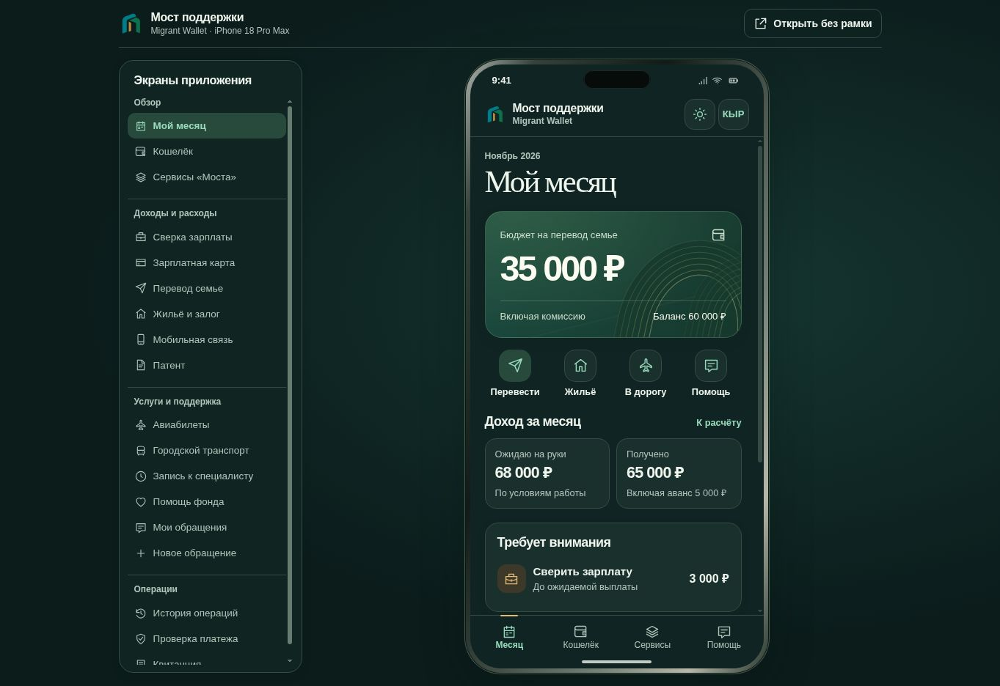

# Мост поддержки · Migrant Wallet

Интерактивный прототип для мигранта. В одном приложении можно сверить зарплату, спланировать расходы, перевести деньги семье, получить услугу и передать выбранные материалы в обращение.

[Открыть приложение](https://vsvld778.github.io/most-migrant-platform/) · [Посмотреть в рамке iPhone с оглавлением](https://vsvld778.github.io/most-migrant-platform/?frame=1#month).

Интерфейс на русском и кыргызском. Демо-сценарии сохраняются в текущем браузере. Курс, суммы, реквизиты, поставщики и результаты операций демонстрационные. Для примеров используйте вымышленные данные.

## Локальный просмотр

Запустите `python3 -m http.server 8000` в каталоге проекта и откройте `http://localhost:8000/`. Приложение использует нативные модули JavaScript, HTML и CSS. Сборка и зависимости не требуются.
